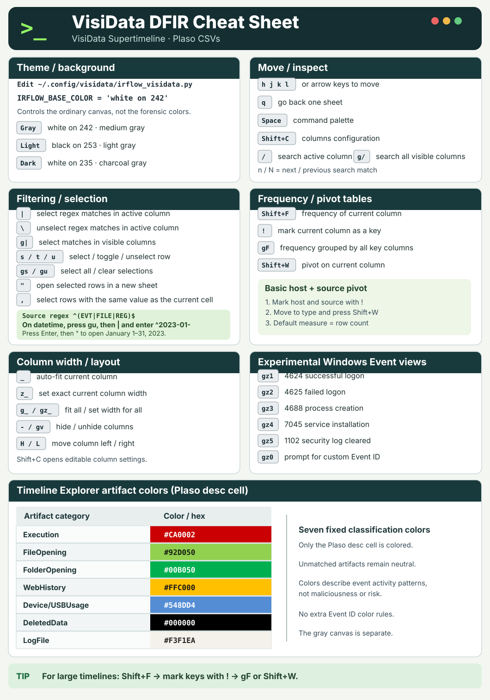

# VisiData Supertimeline

A practical, step-by-step guide to examining forensic CSV supertimelines with **VisiData**. No Python or VisiData experience required.

This standalone VisiData extension reproduces Eric Zimmerman's Timeline Explorer **Plaso supertimeline** semantic colors for the `desc` field, retains IRFlow source colors for other supported timeline formats, and adds a combined `datetime` column, editable **Tags** and **Comment** columns, and experimental Windows Event Log analysis views.

**Experimental features.** The Windows Event Log views, including successful and failed logon analysis, are unfinished. They may miss records or extract fields incorrectly. Verify findings against the original EVTX records.

## DFIR quick reference

For everyday investigation commands, pivot tables, frequency filtering, and exports, start with the **[VisiData 3.5 Practical DFIR Guide](./DFIR-GUIDE.md)**.

For a printable one-page reference, open the **[VisiData DFIR Cheat Sheet (SVG)](./visidata-dfir-cheat-sheet.svg)**:



The SVG is a GitHub-renderable vector reproduction of the cheat-sheet artwork. It can be zoomed or printed without losing sharpness. The source VisiData extension and the seven Timeline Explorer artifact rules are unchanged.

## Contents

1. [Features and files](#1-features-and-files)
2. [Install on Arch Linux](#2-install-on-arch-linux)
3. [Configure VisiData](#3-configure-visidata)
4. [Set up Kitty shortcuts (optional)](#4-set-up-kitty-shortcuts-optional)
5. [Open a timeline and use basic controls](#5-open-a-timeline-and-use-basic-controls)
6. [Try the experimental Windows Event views](#6-try-the-experimental-windows-event-views)
7. [Tag rows and write comments](#7-tag-rows-and-write-comments)
8. [How the colors and datetime work](#8-how-the-colors-and-datetime-work)
9. [Troubleshooting](#9-troubleshooting)
10. [Updating, removing, and testing](#10-updating-removing-and-testing)

## 1. Features and files

| Feature | What you will see |
| --- | --- |
| Timeline Explorer-compatible Plaso colors | Only the `desc` cell receives one of seven activity colors, based on the original Timeline Explorer matching logic; unclassified descriptions are left unchanged. |
| Terminal-friendly appearance | The `asciimono` VisiData theme, with Kitty's background inherited by the base screen. |
| Combined date and time | A `datetime` display column at the left of Plaso supertimelines. |
| Annotations | Editable `Tags` and `Comment` columns, normally immediately before `extra`. |
| Experimental Windows Event analysis | Unfinished views for IDs 4624, 4625, 4688, 7045, and 1102, with extractable fields shown separately. |
| Optional keypad commands | `Alt+Shift+Numpad1`–`5` in Kitty; the same views also work with `gz1`–`gz5` in VisiData. |

Example layout (illustrative—not actual evidence):

```text
datetime             source  sourcetype    ...  Tags                 Comment                    extra
01/01/2023 11:42:10  EVT     WinEVTX            Logon, Review        Unexpected source IP       ...
01/01/2023 11:43:12  FILE    Bodyfile           Execution            Investigate executable    ...
```

The repository contains:

| File | Purpose | Installed location |
| --- | --- | --- |
| `irflow_visidata.py` | Main Python extension | `~/.config/visidata/irflow_visidata.py` |
| `irflow-visidata-keys.conf` | Optional Kitty keyboard mappings | `~/.config/kitty/irflow-visidata-keys.conf` |
| `test_irflow_visidata.py` | Developer tests using a mocked VisiData interface | Repository only |
| `README.md` | This guide | Repository only |

**Terminology:** `~` means your home directory. A *sheet* is a table inside VisiData. A *column* is a field; a *row* is an event. *Sidecar* means a separate file used to hold analyst notes without changing the evidence CSV.

## 2. Install on Arch Linux

The commands below use **Fish** shell. They also work on Bash unless otherwise noted.

**Step 1 — Install VisiData and curl**

```fish
sudo pacman -S --needed visidata curl
```

Kitty is **optional**. Install it separately only if you want the special numpad shortcuts and do not already have it: `sudo pacman -S --needed kitty`.

**Step 2 — Create the VisiData configuration folder**

```fish
mkdir -p ~/.config/visidata
```

**Step 3 — Download the main extension**

```fish
curl -fsSL \
  https://raw.githubusercontent.com/Spacechrist/VisidataSupertimeline/main/irflow_visidata.py \
  -o ~/.config/visidata/irflow_visidata.py
```

**Step 4 — Verify that the file is present**

```fish
ls -l ~/.config/visidata/irflow_visidata.py
python -m py_compile ~/.config/visidata/irflow_visidata.py
vd --version
```

`python -m py_compile` is silent on success. It checks Python syntax, not the live keyboard or rendering behavior.

## 3. Configure VisiData

Downloading the extension is **not enough**. VisiData must be told to load it every time it starts.

**Step 1 — Open your user configuration in Nano**

```fish
nano ~/.config/visidata/config.py
```

If the file already has settings, **keep them**. Add the following Python code **once**:

```python
from pathlib import Path

irflow_path = Path.home() / ".config/visidata/irflow_visidata.py"
exec(compile(irflow_path.read_text(encoding="utf-8"), str(irflow_path), "exec"), globals())
```

In Nano: **Ctrl+O**, **Enter** saves the file; **Ctrl+X** exits.

**Why `globals()`?** VisiData runs its config with separate global/local scopes. Explicitly loading this extension into the globals scope avoids scope-resolution problems during module initialization. Do not paste these Python lines into the Fish shell; keep them inside `config.py`.

**Step 2 — Check the syntax**

```fish
python -m py_compile ~/.config/visidata/config.py
```

**Step 3 — Open a real timeline CSV**

```fish
vd ~/Downloads/supertimeline.csv
```

Replace that path with your real CSV location. When a filename contains spaces, use quotes around the full expanded path, for example:

```fish
vd "$HOME/Downloads/Windows timeline.csv"
```

On a **recognized Plaso supertimeline**, you should see a new `datetime` column, the seven Timeline Explorer-compatible **`desc` cell** colors where event descriptions match, and `Tags`/`Comment` when the source file is local and annotation storage is available. Other cells stay at their normal VisiData color. An **ordinary unrelated CSV will not receive timeline-specific features**.

### Correct folder structure

```text
~/.config/
├── visidata/
│   ├── config.py
│   └── irflow_visidata.py
└── kitty/
    ├── kitty.conf
    └── irflow-visidata-keys.conf  (optional)
```

**Do not put `irflow-visidata-keys.conf` inside the VisiData directory.** Kitty reads that file; VisiData loads the Python extension.

VisiData 3.2+ uses `config.py` in its VisiData directory if present, and otherwise falls back to `~/.visidatarc`. See the [official VisiData configuration documentation](https://www.visidata.org/docs/plugins/) if you use custom `VD_CONFIG`, `VD_DIR`, or `XDG_CONFIG_HOME` values.

## 4. Set up Kitty shortcuts (optional)

This section is for **Kitty terminal** users. You can skip it and still run every analysis view by typing the `gz` shortcuts in VisiData.

**Step 1 — Download the Kitty shortcut file**

```fish
mkdir -p ~/.config/kitty

curl -fsSL \
  https://raw.githubusercontent.com/Spacechrist/VisidataSupertimeline/main/irflow-visidata-keys.conf \
  -o ~/.config/kitty/irflow-visidata-keys.conf
```

**Step 2 — Edit the Kitty configuration**

```fish
nano ~/.config/kitty/kitty.conf
```

Add this **single line** once:

```conf
include irflow-visidata-keys.conf
```

Save with **Ctrl+O**, **Enter**, **Ctrl+X**. The full path is also valid:

```conf
include ~/.config/kitty/irflow-visidata-keys.conf
```

Use **one** include line, not both.

**Step 3 — Reload Kitty**

Press **Ctrl+Shift+F5** inside Kitty, or close and reopen Kitty.

**Step 4 — Test the command without the numpad first**

Open the timeline in VisiData. Press **g**, **z**, **1**, as three consecutive keystrokes. Then try holding **Alt+Shift** and pressing **Numpad1** with **NumLock enabled**.

The shortcut file translates the physical keypad combination into ordinary VisiData characters, for example:

```conf
map alt+shift+KP_1 send_text all gz1
```

These mappings apply **globally in Kitty**, not only when VisiData is running. At a Fish prompt, the shortcut can type `gz1` as text; it won't run an investigation there.

If the keypad does nothing, inspect the key Kitty actually sees:

```fish
kitten show-key -m kitty
```

Hold **Alt+Shift** and press **Numpad1**. On one tested keyboard it reports `shift+alt+num_lock+KP_1`. A different keyboard or NumLock state may report a different key name and need different mappings. Exit the key tester with **Ctrl+C**. See [Kitty keyboard mapping documentation](https://sw.kovidgoyal.net/kitty/mapping/).

## 5. Open a timeline and use basic controls

Run VisiData from your terminal:

```fish
vd /path/to/supertimeline.csv
```

Once the table opens, press keys **inside VisiData**. These aren't terminal commands.

| VisiData keys | Purpose |
| --- | --- |
| Arrow keys, or `h` `j` `k` `l` | Navigate cells |
| `/` | Search the current column |
| `|`, then a regex, Enter | Select rows whose current-column values match |
| `s` / `t` / `u` | Select / toggle / unselect current row |
| `gu` | Clear selected rows |
| `"` | Open selected rows as a separate sheet |
| `F` (Shift+F) | See frequencies for values in the current column |
| `-` | Hide the current column |
| `gv` | Unhide all columns |
| `Shift+C` | Open the Columns Sheet to manage columns |
| `H` / `L` | Move the current column left / right |
| `e` | Edit a writable cell |
| `Space` | Run a command by its long name |
| `z` then `Ctrl+H` | Open the Commands Sheet |
| `q` | Return to the previous sheet |

**Example:** Move to the `source` column, press `|`, type `EVT`, press **Enter**. Rows matching the expression are selected. Press `"` to open them in another sheet; press `q` to return.

For wider text fields, you can widen the column through the Columns Sheet (`Shift+C`) or use VisiData's text/cell viewing commands.

## 6. Try the experimental Windows Event views

These unfinished views depend on the Event IDs and fields available in the CSV export. Each view filters the original supertimeline into a **separate sheet** and attempts to extract useful fields from each matched event.

| Keys typed directly in VisiData | Optional Kitty keypad combination | Analysis | Windows Event ID |
| --- | --- | --- | --- |
| `gz1` | Alt+Shift+Numpad1 | Successful logons | 4624 |
| `gz2` | Alt+Shift+Numpad2 | Failed logons | 4625 |
| `gz3` | Alt+Shift+Numpad3 | Process execution | 4688 |
| `gz4` | Alt+Shift+Numpad4 | Service installation | 7045 |
| `gz5` | Alt+Shift+Numpad5 | Security log cleared | 1102 |
| `gz0` | Alt+Shift+Numpad0 | Prompt for any numeric Event ID | Custom |

To see **successful logons**, press **g**, **z**, **1** in the original supertimeline. Matching events appear in a new sheet, with fields such as **Username**, **Source IP**, **Workstation**, and **Logon Type** where extractable. Press **q** to go back.

You can also run these without any shortcut: press **Space**, type `open-irflow-event-4624`, press **Enter**. Or use **z**, **Ctrl+H** to browse the Commands Sheet and find commands beginning with `open-irflow-event`.

**Important forensic limitation:** A view requires a row identifiable as a Windows Event Log record (e.g., `source=EVT`) **and** an explicit Event ID in supported columns or labeled text. A stray number `4624` elsewhere in the description is not a confirmed event match. Traditional Plaso `l2tcsv` exports may omit Event ID or detailed fields, while richer exports may preserve them. Missing values are left blank. **A result of "No confirmed ... records found" means the command worked, not that no such event occurred on the system.**

For more complete logon interpretation, inspect the original EVTX record and verify account field semantics (target versus subject account), IP, logon type, and source host. These views are conveniences, not complete EVTX parsers.

## 7. Tag rows and write comments

For recognized local timelines, the extension adds writable `Tags` and `Comment` columns. If there is an `extra` field, you see:

```text
... | Tags | Comment | extra | ...
```

If `extra` does not exist, the annotation columns appear at the end.

**To tag an event:** Move the cursor to its **Tags** cell, press `e`, and enter comma-separated labels such as `Review, Execution, Suspicious`. Press Enter to save. Tags are trimmed and duplicate labels are removed without regard to case.

**To comment on an event:** Move to the same row's **Comment** cell, press `e`, type a note such as `Unexpected remote login; correlate VPN logs`, and press Enter. The note is saved separately from the CSV. Use filtering on **Tags** later to review your marked events.

### Setting up Nano for longer comments

If an external editor says `$EDITOR not set`, configure Fish:

```fish
set -Ux EDITOR nano
set -Ux VISUAL nano
```

For **visual line wrapping without inserting extra newline characters**, add `set softwrap` to `~/.nanorc` (only once):

```fish
printf '%s\n' 'set softwrap' >> ~/.nanorc
```

Inside Nano, **Alt+$** toggles soft wrapping. You may use VisiData's external-editor feature where supported by the edit prompt.

### Where Tags and Comments are saved

The extension stores annotations as **JSON sidecars**, automatically when edited. By default, they are stored in:

```text
~/.local/share/visidata/irflow-annotations/
```

If `XDG_DATA_HOME` is set, the extension uses that base instead.

Every sidecar filename is derived from the **absolute source CSV path**; each stored annotation also contains the **original row index** and a **digest of the row contents**. Sorting/filtering a sheet does not change the original row identity.

**What this means in practice:**

- The extension does **not** modify your original evidence CSV when saving Tags or Comments.
- Moving/renaming the source CSV results in a different sidecar location; relocating evidence requires relocating or reconciling annotations too.
- Re-exporting, replacing, or reordering the source CSV may prevent previously saved annotations from matching; the extension deliberately avoids applying notes to mismatched rows.
- If a source file changes during an open session, the extension prevents further sidecar saves for that loaded state.
- Keep both the **evidence and annotation JSON files** in your case archive. There is no automatic multi-user conflict resolution if two VisiData sessions edit the same sidecar.
- This preservation guarantee concerns the Tags/Comment feature only; other native VisiData commands can make changes that need separate handling.

## 8. How the colors and datetime work

### Exact Timeline Explorer coloring for Plaso supertimelines

When the CSV contains the standard Plaso columns `date`, `time`, `macb`, `source`, `sourcetype`, and `type`, this extension uses the original **Timeline Explorer Plaso SuperTimeline** logic instead of IRFlow first-seen source colors. It examines each row's `desc`, `source`, and `sourcetype` and colors **only the `desc` column** (the equivalent of Timeline Explorer's `LongDescription` field).

| Activity category | Background RGB / hex | Text color explicitly set by TLE |
| --- | --- | --- |
| `LogFile` | `243,241,234` / `#F3F1EA` | No change |
| `DeletedData` | `0,0,0` / `#000000` | White |
| `Device\|USBUsage` | `84,141,212` / `#548DD4` | No change |
| `Execution` | `202,0,2` / `#CA0002` | White |
| `FileOpening` | `146,208,80` / `#92D050` | No change |
| `FolderOpening` | `0,176,80` / `#00B050` | No change |
| `WebHistory` | `255,192,0` / `#FFC000` | Black |

The matching logic is taken directly from the `SuperTimelineData` constructor in `TLEFileTimelines/Timelines.cs`. It is **case-sensitive**, except where the original C# code explicitly uses `OrdinalIgnoreCase` (URLs and `.lnk`/`.pf` suffixes). Timeline Explorer uses **seven independent condition blocks in order**, not a single `if/elif` ladder. A later matching category overrides an earlier one:

1. `DeletedData`: `RECYCLE`, `DELETED`, `Deleted Registry`, `$Recycle.Bin`
2. `WebHistory`: browser visits/cookies/URLs (including the exact `FILE`/`REG` exclusions), web-history sources
3. `FolderOpening`: shell items, `BagMRU`, `ShellNoRoam/Bags`
4. `FileOpening`: LNK, RecentDocs, recently opened-file indicators, and related descriptions
5. `Device\|USBUsage`: USBSTOR, mount and removable-device indicators
6. `LogFile`: `EVT`, firewall log, `Event Level:` indicators
7. `Execution`: Prefetch, AppCompatCache, Shimcache, RunMRU, UserAssist and similar execution indicators

For exact individual substrings, exceptions, and order, consult the upstream C# source. The list above is a guide, not a new set of broader matching rules.

**Example:** a row whose `desc` contains `Prefetch {` receives the execution color `#CA0002`. A row containing both `BagMRU` and `File Opened` receives **FileOpening** (`#92D050`), because that original rule runs later. A Windows Security Event ID 4688 without a matching execution description remains `LogFile`; **we do not introduce any additional Event ID classification**. These colors are categories, not maliciousness verdicts.

Timeline Explorer leaves **unclassified events uncolored**. This extension does the same. It does not create or overwrite evidence CSV fields.

**Display limitation:** VisiData renders through a terminal's limited color palette. The hex values above are the exact source colors, but the visible background is mapped to the nearest available **xterm-256** color. An exact RGB match to Timeline Explorer's Windows GUI is not guaranteed.

**Other supported timeline formats:** IRFlow's original source-based row colors are retained for non-Plaso profile formats (ForensicTimeline, MacTime, KapeMiniTimeline and PsortTimeline). These profiles still use a first-seen 16-color IRFlow palette, with up to 150 distinct source values taken from the first 5,000 rows (or 2,500 for source files over 5 GiB). They are **not** Timeline Explorer Plaso classification colors.

### Kitty/Dux theme and light mode

The Python extension retains:

```python
options.theme = 'asciimono'
options.color_default = 'white on 242'
IRFLOW_THEME = 'light'
```

**Neutral gray default canvas:** The plugin uses `white on 242` (xterm-256 gray, RGB `108,108,108`, approximately `#6C6C6C`) as the VisiData background, independently of the host's dark/light theme. This makes the **black DeletedData cell background** visually distinct from the ordinary, unclassified timeline area. **`IRFLOW_THEME` affects only non-Plaso IRFlow source colors**; all seven Timeline Explorer artifact colors and their rules are unchanged. The `asciimono` theme is patched before application so its own default does not reset the gray background.

### Dark-host contrast and cursor navigation (VisiData 3.5)

The gray canvas is a **UI preference**, not a semantic artifact color. For comfortable use on the gray background, ordinary cells have explicit white text; for colors with pale backgrounds, the plugin retains its explicit black text.

The Timeline Explorer Plaso layout specifies **background only** for `LogFile`, `Device|USBUsage`, `FileOpening`, and `FolderOpening`. On a light Windows GUI this inherits dark text. On a dark host terminal, however, VisiData may inherit *white* text and display nearly invisible white-on-pale cells. Our terminal renderer now explicitly uses **black foreground** for those four categories and retains the original TLE foregrounds for `Execution` (white), `DeletedData` (white), and `WebHistory` (black). **The seven category/background hexadecimal colors and all matching rules are unchanged.**

For easier navigation, the plugin customizes the `asciimono` theme so **only the active cell** has `bold reverse` highlighting. It disables the theme's full-row reverse highlight and active-column background highlight. This is a **navigation/UI setting**, not a forensic artifact classification rule. If you use a separate VisiData theme or customize theme options later in the session, that theme can override these UI choices.

To check without reinstalling, within an existing VisiData session you can set the options `color_current_row` and `color_current_col` to empty strings, and `color_current_cell` to `bold reverse`. The plugin applies the defaults automatically when loaded.


References: [Timeline Explorer source](https://github.com/EricZimmerman/TLEFilePlugins/blob/master/TLEFileTimelines/Timelines.cs), [exact Plaso layout](https://github.com/EricZimmerman/TLEFilePlugins/blob/master/Layouts/Default/TLEFileTimelines.SuperTimeline.layout), and [official example tests](https://github.com/EricZimmerman/TLEFilePlugins/blob/master/TLEFile.Test/LoaderTests.cs).

### Combined datetime

A recognized Plaso timeline gets a new **string display column** that joins its existing `date` and `time` fields, for example:

```text
date        time      -> datetime
01/01/2023  11:42:10     01/01/2023 11:42:10
```

The original columns are **hidden, not removed**; the timezone is unchanged. Press `gv` to unhide them.

**This is not a parsed timezone-aware datetime type.** Do not assume string sorting across months or years produces chronological order. For sound time correlation, use the original structured timestamps, timestamps in ISO format, or parsed date types.

## 9. Troubleshooting

| Problem | First thing to check |
| --- | --- |
| No colors or new columns | Did you add the `exec(compile(...))` code to the loaded VisiData config? Does the CSV match a supported timeline format? On Plaso, only matching `desc` cells are colored; generic `source=EVT` alone does not paint every cell. |
| `gz1` does nothing | Confirm the extension loads; use **Space**, type `open-irflow-event-4624`. |
| Kitty numpad mapping does nothing | Try `gz1` **directly** first. Then check the Kitty `include` line, NumLock and `kitten show-key -m kitty`. |
| Kitty prints `gz1` into Fish | This is expected outside VisiData: the Kitty mapping sends characters to any active application. |
| No confirmed Event ID 4624 records | The command may be working but no supported, labeled Event ID data was found. Do not interpret this as proof of absence. |
| No Tags or Comment | Check the CSV's required headers, the local file path, and sidecar directory permissions. |
| Tags/Comment don't restore | Was the source moved, reordered, changed, or exported again? Check warnings for mismatched row digests. |
| Strange light/dark colors | The TLE background colors are fixed. The plugin now supplies black text on pale categories for dark terminal backgrounds; update to the newest plugin and restart VisiData. `IRFLOW_THEME` affects only other IRFlow profiles. |
| Missing `date` and `time` | They were hidden intentionally; press `gv` to show all columns. |
| `$EDITOR not set` | Set `EDITOR` and `VISUAL` as shown in section 7. |
| Python syntax error | Run `python -m py_compile ~/.config/visidata/config.py` and the same for `irflow_visidata.py`. |

For non-default VisiData installation paths, inspect these Fish environment variables:

```fish
echo $VD_CONFIG
echo $VD_DIR
echo $XDG_CONFIG_HOME
```

Empty values are normal when no custom path is configured. To force VisiData to use your config:

```fish
vd --config="$HOME/.config/visidata/config.py" "$HOME/Downloads/supertimeline.csv"
```

## 10. Updating, removing, and testing

### Update your extension

If you edited the downloaded Python file yourself, make a backup:

```fish
cp ~/.config/visidata/irflow_visidata.py \
   ~/.config/visidata/irflow_visidata.py.bak
```

Then re-download the latest copy:

```fish
curl -fsSL \
  https://raw.githubusercontent.com/Spacechrist/VisidataSupertimeline/main/irflow_visidata.py \
  -o ~/.config/visidata/irflow_visidata.py
```

To update Kitty's shortcut file, repeat the download in section 4. **Do not add duplicate `include` lines** to Kitty's config. Restart VisiData and reload Kitty after updating.

### Disable the extension

Comment out the `exec(compile(...))` line in your VisiData `config.py`, then restart VisiData. If you also want to disable Kitty shortcuts, remove or comment out the `include irflow-visidata-keys.conf` line in `kitty.conf`.

Neither action deletes the original evidence CSV or your existing annotation sidecars.

### Tests for developers

From a clone of this repository:

```fish
python -m unittest discover -v
```

The offline tests use a **mock VisiData API** to check configuration, original Timeline Explorer fixture classification, all seven categories, rule precedence, and colorizer behavior. They are **not a substitute for validation in real VisiData** or testing on a representative large Plaso timeline. In particular, exercise the keypad bindings in your terminal and independently verify Windows event extraction against known EVTX ground truth.

## Source references and license considerations

- [VisiData documentation](https://www.visidata.org/docs/)
- [VisiData configuration and plugins](https://www.visidata.org/docs/plugins/)
- [VisiData column commands](https://www.visidata.org/docs/columns/)
- [Kitty keyboard mapping](https://sw.kovidgoyal.net/kitty/mapping/)
- [Timeline Explorer plugin source](https://github.com/EricZimmerman/TLEFilePlugins)
- [Timeline Explorer Plaso colors](https://github.com/EricZimmerman/TLEFilePlugins/blob/master/Layouts/Default/TLEFileTimelines.SuperTimeline.layout)
- [Timeline Explorer Plaso matching rules](https://github.com/EricZimmerman/TLEFilePlugins/blob/master/TLEFileTimelines/Timelines.cs)
- [IRFlow Timeline source](https://github.com/r3nzsec/irflow-timeline)
- IRFlow palette: [timeline-palette.js](https://github.com/r3nzsec/irflow-timeline/blob/main/src/constants/timeline-palette.js)
- IRFlow rules: [color-rules.js](https://github.com/r3nzsec/irflow-timeline/blob/main/src/utils/color-rules.js)
- IRFlow profiles: [kape-profiles.js](https://github.com/r3nzsec/irflow-timeline/blob/main/src/constants/kape-profiles.js)

**Acknowledgment:** Plaso/L2TCSV classification and its seven exact color definitions follow Eric Zimmerman's Timeline Explorer source and saved layout. Other supported timeline formats retain IRFlow's source-based coloring and light default palette. Neither is a universal DFIR standard; the Plaso implementation intentionally reproduces a specific tool's behavior.
